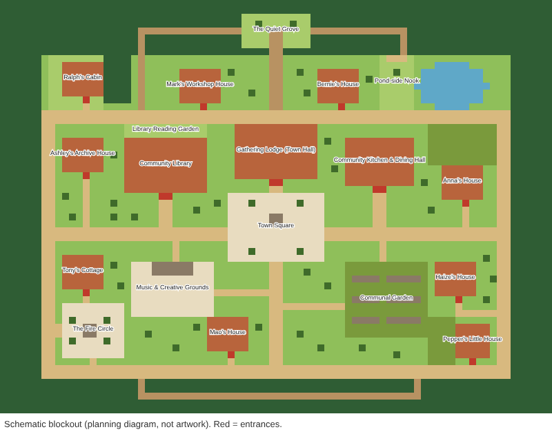

# Proposed World Layout & Five Visual Directions

**Status: for Founder selection. No artwork has been generated and nothing has been spent.**

## 1. The proposed layout

*Flat-colour planning diagram generated from [`canon/world/village_layout.json`](../canon/world/village_layout.json) by `python -m becoming.world_layout --svg`. It is not artwork. Red tiles are entrances. ASCII version: [world/layout_ascii.txt](world/layout_ascii.txt).*

**Structure.** A ring road encloses the village. Two avenues cross at the **Town Square** and its **fountain**. Forest surrounds everything, and trails lead through it.

| Area | Placement and intent |
|---|---|
| Town Square + fountain | Dead centre. The main meeting ground, with four benches and about 130 open tiles for gathering |
| Gathering Lodge (Town Hall) | North of the square, entered from the square |
| Community Library | West of the hall, with a small Reading Garden behind it (a retreat) |
| Kitchen & Dining Hall | East of the hall |
| Communal Garden | Southeast. Planted beds with a central aisle, linked to both the avenue and the south spine |
| Music & Creative Grounds | Southwest. A small stage with open seating |
| Fire Circle | Far southwest beside the forest, with log seats around a pit. Intimate and set away from the centre |
| Pond + Pond-side Nook | Northeast. Water feature with a bench nook reached by a forest trail |
| Quiet Grove | A clearing deep in the north forest, reached only by trail. The main place to withdraw |
| Forest Trails | A north loop (grove ↔ west woods ↔ pond) and a south woodland trail |

**Homes**, each placed to suit its resident:
- **Ralph**: cabin in a forest-edge clearing, NW, screened by trees. Furthest from the centre.
- **Mark**: north, near the hall, overlooking the commons he wants to redesign.
- **Bernie**: north, near the hall and the kitchen. Civic and practical.
- **Ashley**: west, beside the library.
- **Anna**: east, by the pond, with a contemplative garden behind the house.
- **Tony**: southwest, between the music grounds and the fire circle.
- **Mao**: south, near the music grounds, with an outdoor seating circle.
- **Haize**: southeast, beside the communal garden.
- **Pepper**: far southeast corner at the forest edge, small, with her own private garden.

**Verified properties** (automated, `backend/tests/test_world_layout.py`): 12 buildings, all doors on the south wall and reachable both on foot and by path from the square. Required zones exist and are path-connected. Gathering zones meet their open-space minimums. Decor never blocks paths or doors. Negative tests confirm that a broken path, a walled-off house, a misplaced door, overlapping buildings, and a tree on a path are each detected.

## 2. Five visual directions

All five share the **same layout, camera, 16 px scale, and canonical style paragraph**. They differ in season, architectural texture, and landscape. Because Part V already requires seasonal variation, the efficient plan is to choose **one base architecture direction** and treat the seasonal looks as palette-swap overlays.

### A. Golden Spring Commons *(baseline; closest to the canonical paragraph)*
- **Mood:** fresh morning light, blossoms, a village just waking.
- **Architecture:** honey timber frames, terracotta tile roofs, cream stone footings, flower boxes.
- **Landscape:** bright moss greens, fruit trees in blossom, tidy but abundant garden beds.
- **Palette accents:** `#e3a6a1` blossom · `#9cc85e` new grass · `#c2683d` roof · `#f3ead6` stone.
- **Landmarks:** fountain with a cream stone basin. Fire circle of grey river stones.
- **Risk:** can tip into "generic cozy". Distinctive home props are what keep it specific.

### B. High Summer Meadow
- **Mood:** long golden afternoons, heat shimmer, deep shade under trees.
- **Architecture:** same timber and terracotta, with sun-bleached shutters, shade awnings, and pergolas with vines.
- **Landscape:** tall grasses, sunflowers and herbs, a pond with lily pads, dense canopy shadows.
- **Palette accents:** `#c9b458` straw · `#5c9a48` deep leaf · `#e0b36e` sunlit timber.
- **Risk:** high saturation can hurt readability of character sprites. Needs disciplined value contrast.

### C. Harvest Ember Autumn
- **Mood:** amber evenings, lanterns, woodsmoke from the fire circle. Contemplative.
- **Architecture:** timber with cob/plaster infill, terracotta weathered to rust, strings of lanterns.
- **Landscape:** rust, ochre, and plum foliage, pumpkins and squash in the garden, falling-leaf particles.
- **Palette accents:** `#b5562d` rust · `#d99a3e` amber · `#6b4a6e` plum dusk.
- **Risk:** warm-on-warm can muddy the terracotta roofs. Roofs need a cooler shadow ramp.

### D. Riverstone Woodland *(most distinctive architecture)*
- **Mood:** the village grown into the forest. Mossy, misty, intimate.
- **Architecture:** cream river-stone walls, honey timber, and a mix of terracotta roofs and living sod roofs on a few homes (Ralph, Pepper, Anna). Round-topped doors.
- **Landscape:** ferns, mossy boulders, mist on the pond, more trees inside the village, stepping-stone paths.
- **Palette accents:** `#3f7a3e` moss · `#b9ab8e` river stone · `#a7d8e6` mist.
- **Risk:** more trees means more occlusion. Paths need clear contrast. It deviates slightly from "terracotta roofs" everywhere (still present on public buildings).

### E. Lantern Winter Hearth
- **Mood:** snow-hushed evening, glowing windows, breath of warmth from the kitchen.
- **Architecture:** terracotta roofs with snow caps, warm window light, chimney smoke, covered porches.
- **Landscape:** evergreens, frost on the garden beds, a pond iced at the edges, trodden snow paths.
- **Palette accents:** `#e8eef2` snow · `#7f9bb5` cool shadow · `#ffc66b` window glow.
- **Risk:** the white ground lowers contrast for cream stone. Needs a blue-shifted snow ramp.

### Recommendation
**Base direction A (Golden Spring Commons) with D's Riverstone touches**: stone footings, sod roofs on the three most solitary residents' homes, and stepping-stone forest trails. It matches the canonical paragraph most closely while adding character. **B, C, and E become the summer, autumn, and winter seasonal palettes** for simulated months 4–12, so all five explorations get used.

## 3. How the art gets made: options and costs

| Option | What it is | Cost | Consistency | Recommendation |
|---|---|---|---|---|
| **1. Hand/procedurally authored pixel art (by the builder, in code and pixel editors)** | Tiles and sprites drawn at 16 px to the spec, palettes as data | **$0** | Highest (one hand, one palette) | **Recommended** for tiles, buildings, and sprites |
| 2. CC0 / permissively licensed tilesets | Free packs, licence tracked in ASSETS.md | $0 (licence diligence) | Medium. Mixing packs breaks style | Use only for reference or gap-filling |
| 3. Paid AI image generation | Concept paintings or mood boards | Per-image pricing from the chosen service (to be quoted before any use) | Low for grid-aligned tiles. Better for mood art | Optional, for **concept mood boards only**, after explicit approval |

Nothing in options 2 or 3 will be used without your approval. Option 1 needs none.
